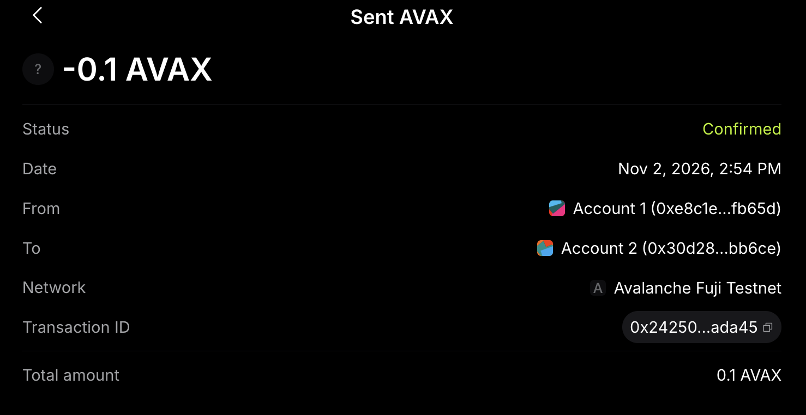
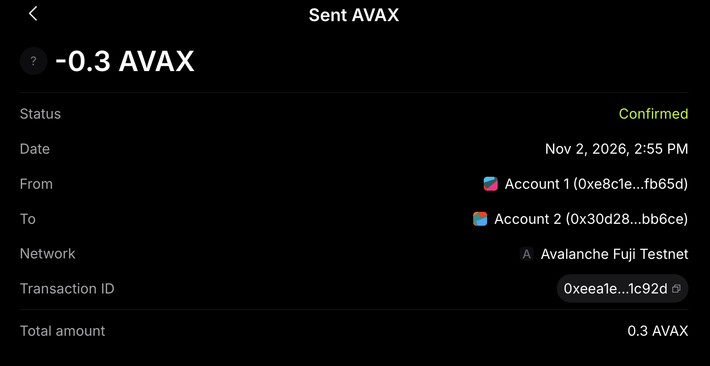
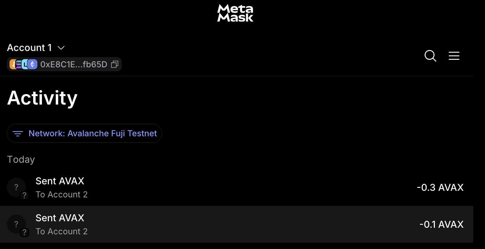

# wallet

Account address: 0xE8C1EF444B0b035C146Be4739E9c5B5C27Ffb65D

# chains

https://scan.test2.btcs.network/address/0xe8c1ef444b0b035c146be4739e9c5b5c27ffb65d

# transactions

Facing an inability to use faucet due to technical issues on Core side, I chose new testnet - Avalanche Fuji.

transaction:
https://testnet.snowscan.xyz/tx/0xba912ae8e7702b0810170c589b4482fd8a248315e2d5b62a6b9e00c2ddfee927

# gas

https://snowtrace.io/insight/leaderboard/gas-tracker 

https://testnet.snowtrace.io/

# nonce

with modified nonce (0.1 AVAX): https://testnet.snowscan.xyz/tx/0x24250cf53621cdb2660a8aa81b4ef8f849a46cd389ace01874f227ab559ada45

with unmodified nonce (0.3 AVAX): https://testnet.snowscan.xyz/tx/0xeea1e43666ed197ca02e66ba6fdc5bb0736db2d857a447fad1ab593afa41c92d

activity logs

