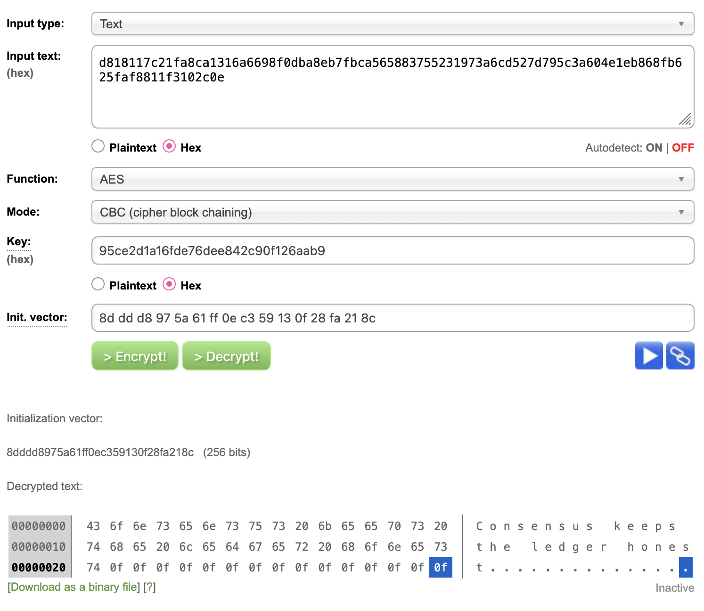

1. Correct symmetric key

To find the correct key I used following shell command:
`echo [KEY] | xxd -r -p | sha256`
and compared the result with expected hash.

Correct key:
`95ce2d1a16fde76dee842c90f126aab9`

2. Decrypted message

Text:
C	o	n	s	e	n	s	u	s		k	e	e	p	s	
t	h	e		l	e	d	g	e	r		h	o	n	e	s
t	.	.	.	.	.	.	.	.	.	.	.	.	.	.	.

3. Asymmetric public key.

-----BEGIN PUBLIC KEY-----
MIGfMA0GCSqGSIb3DQEBAQUAA4GNADCBiQKBgQCSRbOACfd9KLWiKB3+w00ib9Ms
WV5W5uJe6ZTxQ3AwKGhFawfuDg+vr5pSFCe2yyiNjJQVqnYn5cJe1rB0zWME7N7B
7SkidTBFhZaqyIEspEFAg/whqTnxVxvij9IqnLcky6rMtxmPi3Kma4Irz1Gvy1Z7
3/2O/dKmaEk1ZDxIwwIDAQAB
-----END PUBLIC KEY-----

4. Digital signature.

C0dVWDsw5YuydhLQPNVkIjLdJJsmVOiE258liAVuIlfZrURGzGNw/da/+I6js77PcaJRFSgycIwnUK4ofuZiZs+0sxOBPru9UKlc5/qQgHUbUconGp5hDYOhVguHuohdyL22pByr15EKq3bK/Tmy9ehyTaGET9qIL+BOZp8acp0=