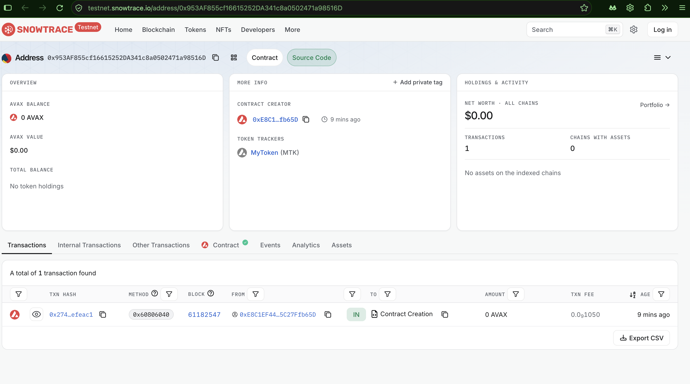

# the Solidity contract (MyToken.sol)

contracts/MyToken.sol

# deployment script (deploy.js) or Ignition module

ignition/modules/MyToken.ts

# test cases for minting, transferring, and balance checks

test/MyToken.ts

# provide the link to your deployed contract and the Blockchain explorer screenshot

link: https://testnet.snowtrace.io/address/0x953AF855cf16615252DA341c8a0502471a98516D

screenshot:

